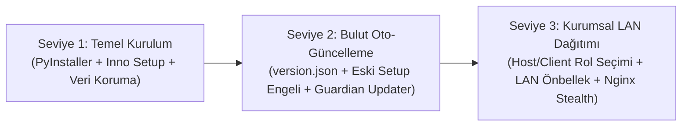

# Masaüstü Uygulaması Kurulum (Installer) & Güncelleme Mimarisi — Rehber ve Ajan Kurulum Sihirbazı

> **Bu doküman iki amaçla hazırlanmıştır:**
> 1. **İnsanlar için:** Modern bir Python masaüstü uygulamasının (PyInstaller + Inno Setup) nasıl tek tıkla paketlendiğini, kullanıcı verisini koruduğunu ve istenirse kendi kendini sessizce güncelleyebildiğini özetler.
> 2. **Yapay Zekâ Ajanları (AI Coding Agents) için:** Bu dosyayı okuyan ajan, kodu körlemesine kopyalamak yerine **aşağıdaki Sihirbaz (Wizard) adımlarını izleyerek** kullanıcıya *"Neler lazım?"* diye sorar ve yalnızca seçilen katmanları projeye temiz biçimde kurar.

---

## 1. Mimariye Kuşbakışı (3 Modüler Seviye)

Bu sistem **tek parça zorunlu bir yapı değildir**; ihtiyaca göre 3 seviyeden biri seçilerek uygulanır:



| Seviye | İçerik | Kimler İçin Uygun? |
| :--- | :--- | :--- |
| **Seviye 1 (Temel)** | Tek kaynaklı sürüm senkronizasyonu, PyInstaller (`--onedir`) + Inno Setup (`Setup.exe`), veri klasörü koruma (`uninsneveruninstall`). | Sadece temiz bir Windows kurulum sihirbazı isteyen, oto-güncellemeye şimdilik ihtiyaç duymayan projeler. |
| **Seviye 2 (Standart + Güncelleme)** | Seviye 1 + `version.json` manifesti + eski `Setup.exe` çalıştırma engeli + SHA-256 doğrulamalı sessiz PowerShell **Guardian Updater**. | Uygulamasını kullanıcılara dağıtıp tek tıkla / sessizce yeni sürüme geçirmek isteyen projeler. |
| **Seviye 3 (Kurumsal LAN / Çoklu Terminal)** | Seviye 2 + Kurulumda `HOST` / `CLIENT` rol algılama + yalnızca Ana Sunucunun buluta çıkıp terminalleri yerel ağdan güncellemesi + Firewall kuralları. | Bir mağazada/ofiste 1 Ana Bilgisayar + birden fazla Terminal çalışan veritabanlı uygulamalar. |

---

## 2. 🤖 AI Ajanı İçin Kurulum Sihirbazı (Agent Wizard Protocol)

> **AJAN TALİMATI (ZORUNLU):**
> Eğer kullanıcı bu dokümanı kendi projesine benzer bir installer/güncelleme sistemi kurmak için paylaştıysa, **hemen kod yazmaya BAŞLAMA**.
> Önce projenin kök dizinini hızlıca incele (giriş dosyası, framework, `requirements.txt`, mevcut klasör yapısı) ve ardından kullanıcıya aşağıdaki **6 Sihirbaz Sorusunu** tek seferde, kısa ve seçmeli şekilde sor.
> Kullanıcının cevabına göre yalnızca gerekli seviyeyi uygula; istenmeyen modülleri (ör. istemiyorsa update sunucusu veya Host/Client mantığını) projeye ekleme.

### Ajanın Kullanıcıya Soracağı 6 Sihirbaz Sorusu

1. **Hangi Seviye Lazım?**
   - **A) Seviye 1 — Sadece Kurulum Paketi (`Setup.exe`)**: Otomatik güncelleme olmasın; sadece tek komutla EXE derleyip profesyonel Windows kurulum dosyası üretsin, güncellemelerde kullanıcı verisini silmesin.
   - **B) Seviye 2 — Kurulum + Bulut Oto-Güncelleme**: Uygulama içi sessiz güncelleme ve eski `Setup.exe` çalıştırıldığında uyarma/yenisini indirme de olsun.
   - **C) Seviye 3 — Kurumsal Ana Sunucu / Terminal (LAN) Mimarisi**: Kurulumda rol seçimi, yerel ağdan terminal güncelleme ve güvenlik duvarı kuralları da eklensin.

2. **Uygulama Teknolojisi ve Giriş Noktası Nedir?**
   - Framework (PySide6 / PyQt6 / Tkinter / CustomTkinter / WebView vb.), giriş dosyası (örn. `main.py`), özel ikon yolu ve PyInstaller'ın kaçırabileceği ağır bağımlılıklar (OCR/ONNX, PyMuPDF, Torch, gizli importlar) neler?

3. **Güncelleme ve Kaldırmada Korunacak Veri Klasörleri Var mı?**
   - Örneğin `data/`, `vault/`, `backups/`, `.db` veya `.json` ayar dosyaları kurulum/kaldırma sırasında korunmalı mı?

4. ***(Sadece Seviye 2 veya 3 seçildiyse)* Güncellemeler Nerede Barınacak?**
   - **A)** GitHub Releases / Public HTTPS CDN
   - **B)** Kendi sunucum (Nginx / Docker / NAS) — Token korumalı dağıtım ister misin?
   - **C)** Henüz belli değil (Şimdilik sadece yerel test / placeholder URL ile altyapı kurulsun)

5. **Geliştirici Konforu & Sürüm Politikası Nasıl Olsun?**
   - Sürüm numarası tek dosyadan (`config.py`) tüm dosyalara otomatik yayılsın mı?
   - Aynı sürüm zaten derlenmişse eski `Setup.exe` üzerine yazmamak için otomatik sürüm artırılsın mı (`1.0` → `1.1`)?
   - Tek tık `.bat` derleme betiği veya basit bir derleme komutu yeterli mi?

6. **Windows SmartScreen & Dijital İmza (Code Signing) İhtiyacı Nedir?**
   - **A)** Elimde OV/EV Code Signing sertifikası veya Azure Artifact Signing var (`SignTool` entegrasyonu kurulsun)
   - **B)** İmza sertifikam yok, ancak son kullanıcıda sıfır SmartScreen uyarısı istiyorum (**Microsoft Store / MSIX** dağıtımına uygun yapılandırma önerilsin)
   - **C)** Şimdilik imzasız olsun (Kurumsal/sınırlı müşteri kitlesi; ilk kurulumda SmartScreen uyarısının normal olduğu biliniyor)

> **Onay Kapısı:** Kullanıcı yanıt verdikten sonra, ajan önce **oluşturulacak/düzenlenecek dosyaların kısa listesini** sunar, onay aldıktan sonra implementasyona geçer.

---

## 3. Seviyelere Göre Teknik Tasarım Reçeteleri

### Seviye 1: Temel Paketleme & Akıllı Kurulum Hattı

#### A. Tek Kaynaktan Sürüm Yönetimi (`Single Source of Truth`)
Sürüm numarası projenin tek bir sabitinden (ör. `core/config.py` → `APP_VERSION = "1.0.0"`) okunur. Paketleme betiği (`build_installer.py`) çalışırken:
1. `installer.iss` içindeki `#define MyAppVersion "..."` satırını günceller.
2. Windows EXE özelliklerindeki sürüm bilgisini (`file_version_info.txt`: `filevers`, `prodvers`, `FileVersion`, `ProductVersion`) eşitler.
3. Çıktı klasöründe o sürüme ait `Setup.exe` zaten varsa (ve `--keep-version` / `--set-version` verilmemişse), eski paketi ezmemek için son haneyi otomatik `+1` artırır (test derlemeleri için `1.2-a` → `1.2-b` desteği eklenebilir).

#### B. PyInstaller Neden `--onedir` + Inno Setup?
- Büyük masaüstü uygulamalarında (`PySide6`, `ONNX`, `PyMuPDF` vb.) PyInstaller'ın `--onefile` modu her açılışta geçici klasöre açma süresi yüzünden yavaş açılır ve antivirüslerde daha sık yanlış pozitif (false-positive) üretir.
- En sağlıklı yaklaşım:
  1. PyInstaller ile **`--onedir --noconsole`** klasör çıktısı üretmek.
  2. Bu klasörü Inno Setup'ın **`lzma2/ultra64`** + **`SolidCompression=yes`** sıkıştırmasıyla tek bir **`MyApp_Setup_vX.Y.exe`** kurulum dosyasına dönüştürmek.
  - Sonuç: Son kullanıcı yine **tek bir `.exe` kurulum dosyası** alır, ama kurulduktan sonra uygulama milisaniyeler içinde açılır.

#### C. Veri Kaybını Önleyen Inno Setup Kuralları (`installer.iss`)
- **Kullanıcı Yetkisi Dostu Kurulum:** `PrivilegesRequired=lowest` ve `PrivilegesRequiredOverridesAllowed=dialog commandline` kullanılarak yönetici şifresi olmayan bilgisayarlarda bile `%LOCALAPPDATA%\Programs\<Uygulama>` altına sorunsuz kurulur.
- **Açık Uygulamayı Güvenle Kapatma:** `CloseApplications=force` ile güncelleme sırasında açık kalmış EXE kilitlenmez.
- **Sıfır Veri Kaybı (`uninsneveruninstall`):**
  ```iss
  [Dirs]
  Name: "{app}\data"; Permissions: users-full; Flags: uninsneveruninstall
  Name: "{app}\data\backups"; Permissions: users-full; Flags: uninsneveruninstall
  ```
  Program Denetim Masası'ndan kaldırılsa bile kullanıcı veritabanı ve belgeler silinmez; isteğe bağlı olarak `CurUninstallStepChanged` içinde kullanıcıya *"Verileriniz güvenliğiniz için korunmuştur"* mesajı gösterilir.

---

### Seviye 2: Eski Setup Engeli & Sessiz Güncelleme ("Guardian Updater")

> *Kullanıcı yalnızca Seviye 1 istediyse bu bölüm atlanır.*

#### A. Güncelleme Manifesti (`version.json`)
Derleme sonunda `build_installer.py` kurulum dosyasının **SHA-256** özetini ve byte boyutunu hesaplayıp `version.json` üretir:
```json
{
  "version": "1.1.0",
  "download_url": "https://updates.example.com/MyApp_Setup_v1.1.0.exe",
  "sha256": "<64_KARAKTER_SHA256_OZETI>",
  "file_size": 124500000,
  "release_notes": "Hata düzeltmeleri ve performans iyileştirmeleri."
}
```

#### B. Kurulum Başında Eski Setup Koruması (`InitializeSetup`)
Kullanıcı elindeki 6 ay önce indirdiği eski `Setup_v1.0.exe` dosyasını çalıştırırsa:
1. Inno Setup Pascal Script içinde `InitializeSetup()` çalışır (`WizardSilent` veya `/SKIPUPDATECHECK` parametresi varsa atlanır).
2. `WinHttp.WinHttpRequest.5.1` ile sunucudan `version.json` okunur.
3. Sunucu sürümü daha büyükse eski kurulumun devam etmesine izin verilmez; kullanıcıya güncel sürümü indirip başlatma seçeneği sunulur.
4. Onay verilirse gömülü bir PowerShell `System.Windows.Forms` ilerleme penceresi (indirilen MB / hedef MB / hız / kalan süre) açılır, yeni `Setup.exe` geçici klasöre indirilir ve `/SKIPUPDATECHECK` parametresiyle başlatılıp eski kurulum sessizce kapanır.

#### C. Uygulama İçi Sessiz Güncelleme ("Guardian PowerShell")
Uygulama açıkken kendi `.exe` dosyasının üzerine yazamayacağı için, güncelleme şu güvenli sırayla yapılır:
1. Uygulama yeni sürümü indirir ve **`SHA-256` doğrulaması** yapar.
2. `%TEMP%` altında bağımsız bir `.ps1` (Guardian) betiği oluşturup başlatır ve ana uygulama `os._exit(0)` ile kendini hemen kapatır.
3. Guardian betiği:
   - Eski sürecin kapandığından (DLL kilitlerinin açıldığından) emin olur.
   - Yeni kurulumu sessiz modda çalıştırır:
     ```text
     /VERYSILENT /SUPPRESSMSGBOXES /NORESTART /SP- /SKIPUPDATECHECK /CLOSEAPPLICATIONS /DIR="<kurulu_dizin>"
     ```
   - Eğer kurulum dizini `Program Files` altındaysa ve yetki hatası alırsa, otomatik olarak `-Verb RunAs` (UAC) ile yine sessiz çalıştırmayı dener.
   - Kurulum bitince güncellenmiş `.exe` dosyasını `--updated` bayrağıyla yeniden başlatır ve geçici kurulum/betik dosyalarını temizler.

---

### Seviye 3: Kurumsal LAN (Ana Sunucu + Terminal) Dağıtımı

> *Kullanıcı yalnızca tek PC'de çalışan bir uygulama yapıyorsa bu bölüm tamamen atlanır.*

#### A. Neden "Server-Bound" (Sunucu Odaklı) Güncelleme?
Çok kullanıcılı yerel ağ uygulamalarında bir terminalin Ana Sunucudan önce yeni sürüme geçmesi **veritabanı şeması uyumsuzluğuna** yol açar. Bunu önlemek için:
- **Kurulumda Rol Seçimi (`app_mode.json`):** Kurulum sihirbazına `CLIENT` (Terminal) / `HOST` (Ana Sunucu) seçim sayfası eklenir. Mevcut dizinde veritabanı veya lisans dosyası varsa `HOST` otomatik algılanır; kullanıcı yanlışlıkla `CLIENT` seçerse veri/servis kaybına karşı onay uyarısı çıkar.
- **Sadece Ana Sunucu Buluta Çıkar:** `HOST` buluttan yeni `Setup.exe` paketini indirip kendi `data/updates/` klasöründe yalnızca son sürümü önbellekler (eskileri temizler).
- **Terminaller Yalnızca Ana Sunucuyu Dinler:** `CLIENT` uygulamalar ve `CLIENT` kurulum sihirbazı sürüm kontrolü için doğrudan `http://<HOST_IP>:<PORT>/api/update/check` ve `/api/update/download` uç noktalarına bağlanır; internet bant genişliği korunur ve sürüm eşitsizliği sıfırlanır.
- **Ağ İzni:** Kurulum aşamasında yönetici yetkisi varsa seçili TCP/UDP portları için `netsh advfirewall` kuralı eklenir.

#### B. İsteğe Bağlı Stealth (Hayalet) Dağıtım Sunucusu (Docker + Nginx)
Güncelleme dosyalarının dışarıdan rastgele taranmasını engellemek isteyen ekipler için:
- Nginx arkasında sadece özel bir doğrulama başlığı (ör. `X-Dist-Token: <GIZLI_TOKEN>`) gönderen istemcilere `/updates/` erişimi verilir; tarayıcıdan doğrudan açanlara `404` dönülür.
- İsteğe bağlı olarak `/indir` gibi genel bir uç nokta sabit en güncel `Setup.exe` dosyasını sunabilir.

---

## 4. Üretimde Karşılaşılan Kritik Tuzaklar (Ajan İçin Kontrol Listesi)

- **Bulut Senkronizasyon Klasörü Kilidi (`Google Drive` / `OneDrive`):** Proje `G:\` gibi senkronize bir klasördeyse Inno Setup derleme sırasında `Error 32 (file in use)` verebilir. Çözüm: `ISCC.exe` çıktısını ve `TEMP`/`TMP` dizinini önce yerel `C:\Users\...\AppData\Local\Temp` altına yönlendirip, derleme bitince `dist_installer/` klasörüne kopyalamak.
- **Kısır Güncelleme Döngüsü:** İndirilen güncel `Setup.exe` başlatılırken mutlaka `/SKIPUPDATECHECK` parametresi geçilmelidir; aksi halde sürüm kıyaslamasındaki ufak bir fark sonsuz indirme döngüsü yaratabilir.
- **Türkçe Karakter Kodlaması:** `installer.iss` dosyası Inno Setup derleyicisi tarafından okunurken Türkçe karakterlerin bozulmaması için dosya kodlaması (UTF-8 BOM veya Windows-1254) ile Python'daki okuma/yazma kodlaması tutarlı tutulmalıdır.
- **Terminal Disk Şişmesi:** LAN dağıtım mimarisinde kurulum `.exe` önbelleği (`data/updates/`) yalnızca `HOST` makinede tutulmalı, `CLIENT` makinelerde temizlenmelidir.
- **Asla Gizli Bilgi Gömme (Şablon Paylaşım Kuralı):** Başka projeye uyarlarken token, sunucu IP'si veya domain adresleri ortam değişkeni / yapılandırma dosyası üzerinden alınmalıdır.

---

## 5. Windows SmartScreen & Dijital İmza Gerçeği (Önemli Uyarı)

Müşteriler web'den indirilen bir `Setup.exe` dosyasını çalıştırdığında **Windows SmartScreen ("Windows kişisel bilgisayarınızı korudu / Bilinmeyen yayımcı")** uyarısı görebilir. Bu konuda ajanın ve geliştiricinin bilmesi gereken güncel kurallar şunlardır:

- **Kod/Installer Ayarı ile Atlatılamaz:** PyInstaller veya Inno Setup ayarlarıyla SmartScreen kapatılamaz; self-signed (kendi ürettiğiniz) sertifika da dışarıdaki müşteri bilgisayarlarında SmartScreen'i aşmaz.
- **EV Sertifikada "Anında Güven" Dönemi Bitti:** Microsoft, geleneksel EV Code Signing sertifikalarının ilk indirmede anında SmartScreen bypass ayrıcalığını kaldırmıştır. OV, EV veya Azure Artifact Signing ile imzalanan yeni bir sürüm bile yeterli indirme itibarı (reputation) birikene kadar uyarı gösterebilir; ancak aynı sertifika kullanıldığı sürece **yayımcı itibarı korunur** ve sonraki güncellemelerde uyarı hızla kalkar.
- **`SignTool` Entegrasyonu:** Geçerli bir Code Signing sertifikası varsa, ajan `installer.iss` `[Setup]` bölümüne `SignTool=...` ve `SignedUninstaller=yes` direktiflerini ekleyerek hem EXE'yi hem `Setup.exe` + `unins000.exe` dosyalarını otomatik imzalayacak şekilde kurar.
- **Sıfır SmartScreen Uyarısı İçin Tek Resmi Yol (Microsoft Store):** Paketi **Microsoft Store** üzerinden yayınladığınızda Microsoft uygulamayı kendi sertifikasıyla yeniden imzalar; böylece son kullanıcıda SmartScreen uyarısı **hiç çıkmaz**.
