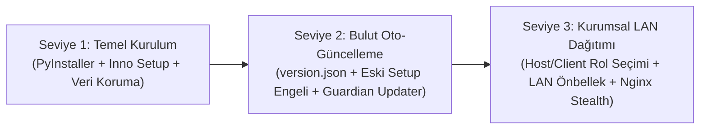

# Python + Inno Setup Akıllı Kurulum ve Güncelleme Mimarisi (AI Wizard Rehberi)

Windows masaüstü Python uygulamaları (**PySide6 / PyQt / Tkinter / CustomTkinter** vb.) için **PyInstaller (`--onedir`) + Inno Setup 6 (`lzma2/ultra64`)** tabanlı, modüler kurulum ve isteğe bağlı sessiz güncelleme mimarisi rehberi.

Bu repo sadece kod örneği değil, aynı zamanda **AI Kodlama Ajanları için Etkileşimli Bir Kurulum Sihirbazı (Agent Wizard)** içerir: rehberi okuyan ajan doğrudan karmaşık kod yığınları üretmek yerine önce *"Sana bu katmanlardan hangileri lazım?"* diye sorar ve yalnızca seçtiğin seviyeyi projenize kurar.

---

## 🎯 Neden Bu Mimari?

Standart Python paketleme yöntemlerinde sık yaşanan sorunları tek yapıda çözer:

- **Tek Kaynaktan Sürüm Takibi:** `APP_VERSION` tek yerden yönetilir; `installer.iss` ve Windows EXE metadata (`file_version_info.txt`) otomatik senkronize edilir.
- **Yanlışlıkla Eski Sürümün Üzerine Yazmama:** Aynı sürüm zaten derlenmişse otomatik sürüm artırma (`1.0` → `1.1` veya `-a` → `-b`) koruması.
- **Hızlı Açılış + Tek Kurulum Dosyası:** PyInstaller `--onedir` (antivirüs false-positive riskini ve açılış gecikmesini azaltır) + Inno Setup `lzma2/ultra64` tek `Setup.exe`.
- **Sıfır Veri Kaybı:** `data/`, `backups/` gibi klasörler `uninsneveruninstall` ile korunur; program güncellenirken veya kaldırılırken veritabanı asla silinmez.
- **İsteğe Bağlı Akıllı Güncelleme (Seviye 2 & 3):**
  - *Eski Setup Engeli:* Kullanıcı eski bir `Setup.exe` çalıştırırsa sunucudaki güncel sürümü görüp indirir.
  - *Guardian Updater:* SHA-256 doğrulamalı, PowerShell üzerinden sessiz (`/VERYSILENT`) güncelleme ve otomatik yeniden başlatma.
  - *Server-Bound LAN Dağıtımı:* Çoklu terminal yapılarda yalnızca Ana Sunucu (`HOST`) buluta çıkar; Terminaller (`CLIENT`) güncellemeyi yerel ağdaki Ana Sunucudan alır.

---

## 🧩 3 Modüler Seviye

- **Seviye 1 (Temel):** Sadece `Setup.exe` üretimi ve veri koruma *(güncelleme sunucusu gerektirmez)*.
- **Seviye 2 (Standart + Güncelleme):** `version.json` manifesti + eski kurulum engeli + sessiz PowerShell güncelleme.
- **Seviye 3 (Kurumsal LAN):** Ana Sunucu / Terminal rol algılama + yerel ağdan güncelleme + güvenlik duvarı kuralları.

---

## 🤖 Kendi Projende Nasıl Kullanırsın?

1. Bu repodaki [`INSTALLER_WIZARD_REHBERI.md`](./INSTALLER_WIZARD_REHBERI.md) dosyasını indir (veya ham URL'sini kopyala).
2. Kendi projenin bulunduğu ortamda kullandığın yapay zekâ kodlama ajanına şu komutu ver:
   > *"Bu `INSTALLER_WIZARD_REHBERI.md` dosyasını oku. İçindeki **Agent Wizard** kurallarına uyarak önce benim projemi incele ve bana kurulum sihirbazı sorularını sor; seçtiğim seviyeye göre kurulum altyapısını projeme kur."*
3. Ajan sana 5 kısa soru soracak; örneğin sadece **Seviye 1** seçersen update sunucusu veya LAN karmaşası eklemeden temiz bir `Setup.exe` hattı kuracak.

---

## 📂 Repo İçeriği

| Dosya | Açıklama |
| :--- | :--- |
| [`README.md`](./README.md) | Genel tanıtım, mimari özet ve hızlı kullanım talimatı |
| [`INSTALLER_WIZARD_REHBERI.md`](./INSTALLER_WIZARD_REHBERI.md) | 3 seviyeli teknik reçeteler, üretim tuzakları ve AI Ajanı Kurulum Sihirbazı protokolü |
